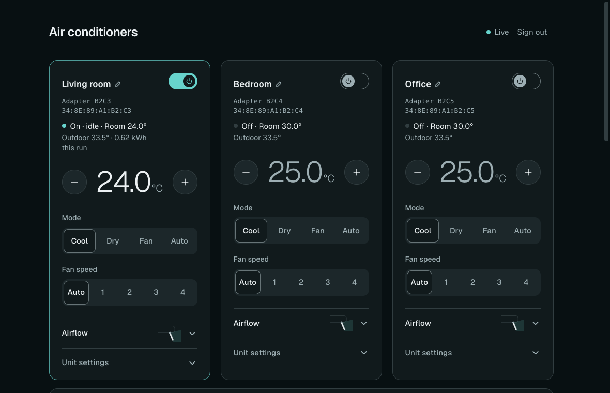
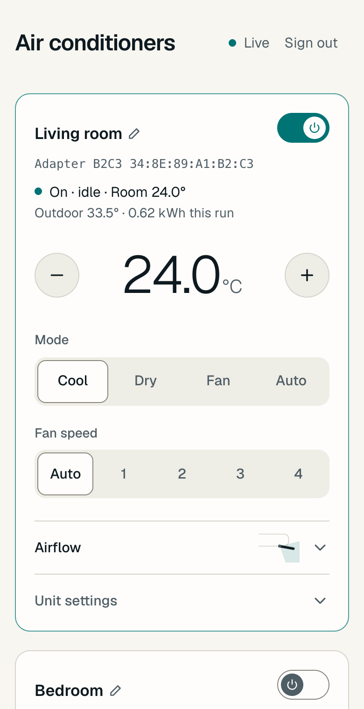

# my-missyoubibi

Control your Mitsubishi Heavy air conditioners from a fast web page on your own network, instead of the slow official app.
It talks to the units' existing **WF-RAC Wi-Fi adapters** over your local network. The default, the **Home deployment**, runs entirely on your own
network: no cloud, no account, no extra hardware. An optional [Cloud deployment](docs/cloud-deployment.md) runs the page and the broker on a
VPS of yours and keeps only the bridge at home.

> The name is a joke from someone who got tired of waiting for the official app to load.
> **Unofficial.** Not affiliated with, endorsed by or sponsored by Mitsubishi Heavy Industries. It drives real hardware over a
> protocol the manufacturer doesn't document: use it at your own risk. See [NOTICE](NOTICE) and the [licence](LICENSE) (MIT).

<p>
  
  
</p>

## What it does

- **Per unit:** power, mode (cool, dry, fan, auto), setpoint (18 to 30 °C in half degrees), fan speed (auto, 1 to 4), silent mode.
- **Airflow:** up/down louver (4 positions and swing) and left/right louver (7 positions and swing), shown as pictures of the flap
  and fins, plus 3D auto.
- **Status:** cooling or idle, room temperature and humidity (where the unit has a sensor), outdoor temperature, energy this run, unit fault codes, online or offline.
- **Timers:** weekly on/off schedules and one-shot timers ("off in 2 hours"). "Turn on" can also set mode, temperature and fan.
- **Energy report:** today, last 7 days, this month, per unit, with a 14-day chart and an optional cost estimate.
- **Units:** find the adapters on your network, add one by its MAC (or the Smart M-Air QR text), rename or remove it from the page.
  Steps to get a brand-new adapter onto your Wi-Fi are built in.
- **Phone friendly:** installable on a home screen, light and dark themes.
- **Home Assistant:** optional MQTT discovery.

Not possible over this interface: ECO, Hi power and Home-leave (only the remote does those) and self-clean.

## Quick start

You need Docker (or Podman) with Compose, Node.js 24 or newer, and git, on a computer that stays on at home
(a Raspberry Pi is ideal). Your units must already work in the Smart M-Air app, on a 2.4 GHz Wi-Fi network.

```bash
git clone https://github.com/m0ndez/my-missyoubibi
cd my-missyoubibi
npm run setup
```

Setup detects your network, writes `.env` with strong generated secrets, asks whether to serve the page to phones on your Wi-Fi (and prints the address), and starts everything. Open http://localhost:3000, sign in
with the password in `.env` (`APP_PASSWORD`), and use **Add a unit → Find units on my network**. The first run starts with no units.

Next: [install details](docs/install.md) (phone and remote access with HTTPS, updating, backup, uninstall),
[add a unit](docs/add-a-unit.md), [troubleshooting](docs/troubleshooting.md), [Cloud deployment](docs/cloud-deployment.md) (control from anywhere).

## How it works

```
 browser ──▶ app ◀──MQTT──▶ mosquitto ◀──MQTT──▶ bridge ──HTTP(S) :51443──▶ WF-RAC adapters
```

In the Home deployment, three containers: the **app** (web page, API, timers, energy), a **broker**, and a **bridge** that finds each adapter by its MAC,
polls it every 5 seconds and sends your changes. The page never talks to an adapter directly. More in
[architecture](docs/architecture.md); the adapters' protocol is written up in [firmware notes](docs/firmware.md).

## Security in one paragraph

One shared password (the app refuses to start with a weak one), signed session cookies, a same-origin check on every change, a
broker with per-user access rules, and the app listening on localhost only until you put HTTPS in front of it. The adapters have no
login of their own: anyone on your LAN can already control them. In the Home deployment, never expose the app or the broker to the internet.
The Cloud deployment is built to be exposed, in a different way: see its [security model](docs/cloud-deployment.md#security-model). Read
[SECURITY.md](SECURITY.md) before opening either up.

## Models

Tested on an SRK24YYS, an SRK18YYS and a DXK12YYS. Other WF-RAC units (the "ZS" wall units are reported working elsewhere; many
ranges are only listed by sellers): [supported models](docs/supported-models.md). Please report yours.

## Development

```bash
npm ci
npm run backend     # broker and bridge in Docker (finds your adapters)
npm run dev         # the web app on http://localhost:3000, with hot reload
```

No hardware? `npm run sim` is a broker with fake units. Before a pull request: `npm run typecheck && npm run lint && npm run check`,
then `npm run build && npm run e2e` (a full smoke test with a fake adapter). See [CONTRIBUTING.md](CONTRIBUTING.md). Don't run the
app container and `npm run dev` at the same time. `npm run` lists the rest (`provision`, `fake`, `wfrac`).

## More

[Changelog](CHANGELOG.md) · [Known issues](docs/known-issues.md) · [Security](SECURITY.md) · [Contributing](CONTRIBUTING.md)

## Credits

How the adapters' local API works was learned from the community project
[Mitsubishi WF-RAC Integration](https://github.com/blues-sechseck/Mitsubishi-WF-RAC-Integration) by jeatheak and contributors (MIT),
and from watching real units. MHI's own manuals describe getting an adapter onto Wi-Fi (sources in [add a unit](docs/add-a-unit.md)).

## Licence

[MIT](LICENSE). "Mitsubishi Heavy Industries", "Smart M-Air" and "WF-RAC" belong to their owners.
